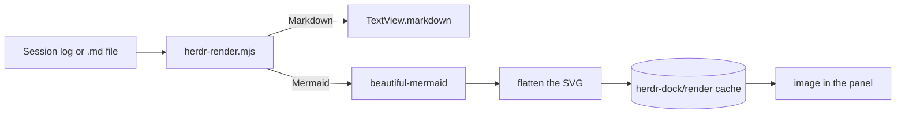

# Render panel — design and plan (short)

Date: 2026-11-22.

## Intent

Agents answer in Markdown, often with Mermaid diagrams, and a terminal shows them as raw text. The user wants them
drawn, beside the terminal, without giving up Claude Code's terminal UI. Chosen: a **right-panel mod**, `dock-render`,
that renders (1) the focused agent's **latest answer**, (2) **all diagrams** of its session, newest first, (3) the
**Markdown files** in its folder; for **Claude Code and Codex**.

## Looked at

- **herdr-kanso `markdown-panel`** (Apache-2.0): a Markdown file viewer/editor window. Files only, no Mermaid.
- **herdr-chat** (MIT): replaces the agents' terminal UI with a native chat; renders Mermaid with `beautiful-mermaid`
  (pure JS, no browser) and flattens its SVG for a native renderer (`host/mermaid.ts`). macOS/Linux, Node 24, a host
  process. Too big a change; its Mermaid approach is what we reuse (ported, credited).

## Design



- **Markdown**: gpui-kit's `TextView.markdown` draws it natively. A message is split into segments: Markdown text,
  and ```` ```mermaid ```` blocks drawn as images.
- **Diagrams**: a Node helper (`herdr-render.mjs`, bundled with `beautiful-mermaid` by the build, nothing to install)
  renders each Mermaid block to an SVG in `<app home>/herdr-dock/render/` (named by a hash of the source and the
  theme, so each is rendered once), flattened for Herdr's renderer (no CSS variables, `color-mix()`, `@import` or
  `foreignObject`), coloured from the Herdr theme. `image("herdr-dock/render/<file>.svg")` shows it. A diagram that
  doesn't render shows its error and source.
- **Which agent**: the focused pane's agent, else the tab's first agent.
  - Claude Code: `hc get <terminal>` gives the foreground pid; `~/.claude/sessions/<pid>.json` gives `sessionId` and
    `cwd`; the transcript is `~/.claude/projects/<cwd as a slug>/<sessionId>.jsonl` (can be many MB: the helper
    streams it; Herdr's readTextFile stops at 1 MiB).
  - Codex: the newest `~/.codex/sessions/**/rollout-*.jsonl` whose `session_meta` cwd is the pane's folder.
- **Latest answer**: the assistant text after the last real user message (tool results don't count).
- **Diagrams**: every Mermaid block in the session's assistant messages, newest first, each with when it came.
- **Files**: `.md` files under the agent's folder (depth 3, no `node_modules` / `.git`), newest first; one opens
  formatted, read-only, its diagrams drawn.
- **Updates**: a folder watch on the transcript's folder re-reads after a change (debounced); switching agent or tab
  re-reads at once. Nothing runs while the panel is hidden.
- **Zoom**: clicking a diagram opens it in a large dialog (the same mod as an overlay, `props.zoom`).

## Plan

1. Pure core, tested: segment split and Mermaid blocks, hashes, transcript readers (Claude, Codex), latest answer,
   diagrams, the SVG flattening (ported from herdr-chat), the project slug.
2. The helper (`src/app/render-helper.js`, bundled with `beautiful-mermaid` into `mods/dock-render/herdr-render.mjs`):
   modes `claude`, `codex`, `file`, `list`; tested on fixtures.
3. The mod: agent detection, the three views, watch/refresh, zoom; `herdr-app check`; tried live.
4. Default right region gets Render; README, RECIPE.
