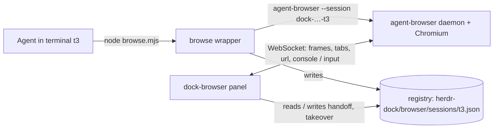

# dock-browser: a browser beside each agent, design

Date: 2026-11-23 · Status: draft for approval

## Intent

The user liked cockpit's built-in browser (quaresc/cockpit, `browser/`, `docs/browser.md`) and wants it in herdr-dock.
What they use it for, in their words:

- **Mainly: UI workflow debugging.** They give the agent a flow; the agent drives it in the browser until it finds the
  bug. Also **security checks**: the agent probes the app for security bugs.
- **Sometimes: UI layout design and debugging**, where cockpit's **Pick and Notes** (point at elements and send them to
  the agent) help.
- They test on **local, dev, alpha and production**.
- They take over the page themselves **mostly when the agent needs them**: username and password, 2FA, captcha.

Cockpit's version can't be ported: its Chromium window runs on macOS only (an Electron window laid over the Herdr window
by a macOS window tracker, through a background hub), and herdr-dock must work on Windows, macOS and Omarchy with no
background service. What cockpit's agents actually use is **agent-browser** (Vercel, Apache-2.0, a native CLI with
builds for all three systems), which drives Chromium over CDP. herdr-dock builds on agent-browser directly.

Three steps, agreed in that order:

1. **Agent side**: a `browse` command and a skill, one browser per agent session, two profiles, handoff.
2. **The panel**: a right-panel mod showing the session's page live, with take-over, Pick and Notes, page sizes and the
   console error count.
3. **Later**: a real Chromium window (outlined at the end, not designed here).

## Goals

- An agent in any Herdr terminal opens and drives a real browser with one command, on all three systems.
- Each agent session has its own browser; the panel shows the one of the agent in front.
- Two profiles: **clean** (new and empty every time) and **signed-in** (logins kept, shared by all sessions).
- The agent can hand the page to the person (login, 2FA, captcha) and wait; what the person types goes to the page only.
- The person sees the page live, can take over, and can point at elements for the agent.
- Production hosts are named in config and treated more strictly.

## Non-goals

- Browsing for the person: the panel is for watching and short take-overs, not a replacement for their own browser.
- Cockpit's profile management (import cookies from other browsers, per-repo/per-worktree profiles), downloads list,
  DevTools inside Herdr, history and address-bar suggestions.
- Remote agents (an agent running on another machine): not followed, as in Render.
- Step 3 (a real Chromium window).

## Anti-goals

- **Platform lock-in**: anything that works on one system only because of how it was written.
- **A background service** of herdr-dock's own. agent-browser's per-session daemon is agent-browser's, started and
  ended by it.
- **Credentials in the agent's context**: the person's typed password, 2FA code or captcha answer must never be written
  to the agent's terminal, the skill's output, logs or the session registry.
- **Pretend safety**: the production rules are guidance to the agent plus visible warnings, and the docs say so. Nothing
  claims to block what it can't.
- **The person's own logins used for probing**: security checks run on the clean profile.

## Constraints and what the spike proved

A throwaway spike (2026-11-23, Omarchy, agent-browser 0.43.0, system Chromium) showed:

- **agent-browser streams every session** over a localhost WebSocket (`agent-browser --session S stream status --json`
  gives the port). Messages: `frame` (base64 JPEG + metadata), `status`, `tabs`, `url`, `console`. It takes input back:
  `input_mouse` (`mouseMoved`, `mousePressed`, `mouseReleased`, `mouseWheel` with `deltaX/deltaY`), `input_keyboard`
  (`keyDown`/`keyUp` with `key` and `text`), and `config {maxFps}` (also on the URL: `/?maxFps=15`).
- **A mod can hold that WebSocket** (`import { WebSocket } from "websocket"`): ~12 frames/s at maxFps 15, frames
  30–40 ms old, base64 decode ~23 ms in JS (try `Buffer.from(s, "base64")` first, it should be faster).
- **`image()` takes a path relative to the app home** (`spike-browser/frames/f1.jpg`); an absolute path draws nothing.
  Render already does this (`herdr-dock/render/<file>.svg`).
- **A new image path draws nothing until it loads.** Swapping frames flickered (6 of 15 shots blank). Drawing the
  previous frame underneath the new one (two absolutely placed layers) fixed it (20 of 20).
- **The stream's `metadata.deviceHeight` is wrong** (720 for a 633 px viewport). Take the frame's size from the JPEG
  header (SOF marker); frame pixels are the page's CSS pixels at scale 1, so a click maps as
  `css = local_position × frameWidth / drawnWidth` on both axes.
- **Keys work** from a focused element (`cx.focus_handle()`, `track_focus`, `on_key_down`, focus on mouse down).
  Mapping used: `enter→Enter` with text `"\r"`, `backspace`, `tab`, `escape`, arrows, `space→" "`, else `key_char`.
- **Scroll**: send `-delta` of `on_scroll_wheel`; felt right to the user.
- **Overlay windows work**: `mod.json` `"overlay": {"kind": "window", …}` and `herdr-app do mod.open --name <mod>`.

Other constraints:

- Mods can't use a web view, Node APIs or `setTimeout` (`~/.config/herdr-app/AGENTS.md`); they can `exec`, use
  `fs/promises` (write only under the app home), WebSocket and `cx.timer`.
- Node 22+ is on all three machines and may run outside Herdr (Render's `herdr-render.mjs` precedent).
- An agent's terminal has `HC_TERMINAL_ID` (e.g. `t1`) and `HC_SCOPE` in its environment.
- The right panel is 360 px by default.

## Approaches considered

- **A. Live stream into the panel** (chosen): the mod holds agent-browser's stream WebSocket, draws frames with
  `image()`, sends input back. Live (~12 fps), real take-over, console for free. Risks (socket allowed, flicker) were
  settled by the spike.
- **B. Screenshot polling**: `agent-browser screenshot` about once a second, each input a separate command. Only known
  features, but ~1 fps, sticky typing, polled console. Kept as the fallback if A breaks on another system.
- **C. A relay helper** holding the socket and writing frames for the mod: only needed if a mod couldn't hold a socket;
  the spike showed it can.

The user picked A, then confirmed it with the spike.

## Design

### Overview



### Install (deploy)

- **agent-browser** is pinned in the repo (version, per-OS package and its npm `integrity`), like cockpit's
  `browser/pins.json`. `npm run deploy` downloads the native binary for this machine from the npm registry
  (`@agent-browser/cli-<os>-<arch>`), checks it against the pin and puts it at
  `<app home>/herdr-dock/browser/bin/agent-browser[.exe]`. Already there at the pinned version: nothing is downloaded.
- **Chromium**: config `browser.chrome` names a browser executable (system Chromium, Chrome, Brave). Empty: deploy
  runs `agent-browser install` once (Chrome for Testing). The browser feature is opt-in (`browser.enabled`), so a
  machine that doesn't want it downloads nothing.
- **The skill** is written by deploy (like the status lines are) to `~/.claude/skills/dock-browser/SKILL.md` and
  `~/.codex/skills/dock-browser/SKILL.md` when those folders exist, with this machine's absolute paths filled in.
  `--no-skills` skips it. Antigravity: written too if it has a user skills folder; otherwise skipped and said so
  (builder checks).

### Sessions

- One agent-browser session per agent terminal, named `dock-<HC_SCOPE short>-<HC_TERMINAL_ID>`, so two Herdr homes
  never share one.
- **The registry**: `<app home>/herdr-dock/browser/sessions/<terminal>.json`, written by the wrapper and the panel:
  `{session, terminal, profile, url, title, opened, handoff: {message, since} | null, takeover: bool,
  answer: "done" | "cancel" | null}`. No credentials, no page content. The panel watches the folder.
- A session whose terminal is gone is closed (`agent-browser --session S close`) and its registry file removed: by the
  panel when it refreshes, and by the wrapper on its next run. agent-browser's own idle timeout (1 h) also ends it.

### The `browse` command (step 1)

`node "<app home>/mods/dock-browser/browse.mjs" <subcommand>` (the skill spells out the full path). It finds the
session from `HC_TERMINAL_ID` and refuses to run without one (says the agent isn't in a Herdr terminal).

- `open [--profile clean|signed-in] <url>`: open the page (a `localhost:3000`, a URL or a file path) in the session's
  browser, starting it if needed. Default profile: clean. The profile of a running session doesn't change; asking for
  the other one restarts the session (and says so).
- `action -- <agent-browser command>`: run one agent-browser command on the session (`snapshot -i`, `click @e3`,
  `fill`, `press`, `get text`, `eval`, `console`, `errors`, `network …`, `set viewport`, `set device`, `screenshot`,
  `tab …`). Refused: `close`, `connect`, `--cdp`, `--session`, `--profile` (they'd leave or swap the browser).
  While the person has control (handoff, take-over, Pick or Notes), it doesn't run: it exits 3 at once with
  `the person has control; run browse wait`.
- `handoff "<message>"`: see Handoff. Returns at once (exit 0, "waiting for the person: run browse wait").
- `wait`: waits while the person has control, **at most 9 minutes** per call (under Claude Code's 10-minute ceiling
  for a shell command; the skill tells the agent to run it with the longest timeout its tool allows). Exits 0 when the
  person pressed Done or handed back, 1 for Cancel, 4 when still waiting at the limit (the agent runs `wait` again).
  With nothing pending it exits 0 at once.

**Why it's split (my call):** agents run commands through shell tools that kill long commands (Claude Code: 2 minutes
by default, 10 at most; Codex has its own limit). A command that blocks for a whole handoff would be killed mid-wait
and leave the registry with nobody reading it. Short commands plus a re-runnable `wait` survive any tool limit.
- `login <url>`: for the person, not the agent: opens the signed-in profile in a visible window on `url`; the person
  signs in and closes the window; the logins are saved to the signed-in profile.
- `status`: the session, profile, URL, and whether the person has control. `close`: ends the session.

Every output line that comes from a production page starts with a `PRODUCTION (<host>)` banner (see Production).

### Profiles

- **clean**: agent-browser's default, a fresh browser context; nothing kept.
- **signed-in**: one stored state file, `<app home>/herdr-dock/browser/profiles/signed-in.json` (cookies and local
  storage, agent-browser `state save/load`), loaded when a session starts on it, saved back after `login` and after a
  handoff on that profile. A state file, not a Chrome profile folder, so several sessions can use it at once (a Chrome
  profile folder can be open in one browser only). Last save wins. File mode 0600 where the system has modes; it is
  never in the repo. It holds live session cookies: the README says so.

### Production

- Config `browser.production: ["*.example.com", "app.example.com"]` (host patterns; `*` = any subdomain labels).
- On a production page: the wrapper prefixes its output with the banner, the panel shows a red **Production** tag, and
  the skill's rules apply: no security probing (crafted input, changed requests, other users' IDs) unless the person
  asked for it in this task, and nothing that writes (submit, save, delete, send) without the person.
- Local, dev and alpha are not restricted beyond the general rule below.

### Handoff and take-over

- **Handoff** (the agent asks): `browse handoff "Sign in to alpha, then press Done"` sets `handoff` in the registry.
  The panel switches to take-over mode (highlighted border, the message, **Done** / **Cancel** / **Open in a real
  window**) and posts a notification (`notify`, the existing toast) that opens the panel when clicked. The agent runs
  `browse wait` until the panel writes `answer`. A handoff nobody answers within `browser.handoffMinutes` (default
  15) counts as Cancel, and `wait` says it timed out.
- **Take-over** (the person decides): a **Take over** button sets `takeover`; the agent's `action`s exit 3 until
  **Hand back** clears it. No time limit: the person holds it as long as they need; the agent keeps running `wait`.
- In take-over mode the panel forwards clicks, wheel and keys to the page over the stream. Outside it, the picture
  only scrolls (wheel) and is otherwise view-only, so a stray click never changes the agent's page.
- **What the person types** goes from the panel to the stream socket and nowhere else: not to the registry, logs or
  the agent's terminal. (The agent could still read a filled field from the page later; the skill tells it not to read
  credential fields. Said plainly in the docs.)
- **Open in a real window** (drag-puzzle captchas, passkeys): save the session's state, open a visible window on it at
  the same URL, wait for the person to close it or press Done, save its state, load it into the agent's session and
  reload. Keeps cookies and storage, not half-filled forms.

### The skill

Teaches, in this order: when to use the browser; `open`/`action`; for workflow debugging, after each step check
`errors` and `console` and failed requests, and take a screenshot at each state that matters; security checks on the
clean profile only; the production rules; handoff instead of guessing credentials or solving captchas; never read
credential fields; page sizes (`set device "iPhone 16"`, `iPad`, `set viewport 1440 900`) in a tab of its own; Design
Feedback prompts (below); anything that publishes in the person's name (a review, a comment, a form that sends) is left
on its button for the person. Adapted from cockpit's `side-browser` skill (MIT, credited) where it fits.

### The panel, `dock-browser` (step 2)

A right-panel mod (rail icon after Render; it joins the default right region). It follows the agent in front, the same
way Render does (focused pane's agent, else the tab's first; reuse Render's helper).

- **No browser for this agent**: a short empty state ("No page yet. The agent opens one with `browse open`").
- **What changes the agent's page and what doesn't (my call):** watching, scrolling the picture, Enlarge, the error
  list and the tab list are view-only and work at any time. Everything that changes the page (input, switching tab,
  Pick, Notes) needs the person to have control: pressing it starts a take-over (the agent's `action`s exit 3 until
  Hand back), so the person and the agent never drive the page at once. The size buttons don't touch the agent's
  tab: each opens the current URL in a new tab at that size.
- **Header**: tab title and URL, the profile (clean / signed-in), the Production tag, the console error count (from the
  stream's `console` messages; click: the last errors), and the tab list when there is more than one tab (clicking
  another tab takes over, then switches).
- **The page**: live frames, fit to the panel's width, previous frame underneath (spike). Frames go to
  `<app home>/herdr-dock/browser/frames/<terminal>/`, a few kept, the rest deleted; the folder is cleared when the
  session closes. The stream is opened only while the panel shows; hidden, the socket is closed.
- **Enlarge**: opens the same mod as a large window (`kind: "window"`, props `{big: true}`), for take-over and Pick.
- **Sizes**: phone / tablet / desktop buttons open the current URL in a new tab with `set device` / `set viewport`
  (the agent's own tab keeps its size).
- **Take over / Hand back**, and the handoff mode above.
- **Pick** (one element) and **Notes** (several, numbered, up to 20 a page), as in cockpit: pick mode installs a small
  script in the page (`agent-browser eval`) that highlights the element under the pointer (pointer moves arrive
  through the stream) and records a click without passing it to the page. The note is typed in the panel (a Herdr text
  field), not in the page. **Send** builds a `## Design Feedback` prompt (per element: selector, text, the person's
  note, React source file and line when the page is a dev build, the path of a cropped screenshot under
  `<app home>/herdr-dock/browser/picks/`) and types it into the agent's terminal as its next prompt. Values that look
  like secrets are left out. Port the logic of cockpit's `browser/main/design.js` and its grab scripts where it fits
  (MIT, credited).

### Step 3, later (not designed here)

A real Chromium window per session: on Omarchy tiled next to Herdr by Hyprland, on macOS docked the way cockpit does,
on Windows owned by the Herdr window. Revisit after steps 1 and 2 are in daily use.

## Config

In `config/dock.json` (per-machine overrides in the local file, as usual):

```jsonc
"browser": {
  "enabled": false,          // opt-in: deploy downloads agent-browser (and Chrome for Testing) only when true
  "chrome": "",              // a browser executable; empty: Chrome for Testing
  "production": [],          // host patterns treated as production
  "handoffMinutes": 15
}
```

**Off means absent (my call).** With `enabled: false`, deploy installs nothing of the browser: no agent-browser, no
`dock-browser` mod, no skills, and the panel isn't in the right region (it joins the default right region only when
enabled). That way no agent is told about a command that can't run. Turning it on later is `enabled: true` and
`npm run deploy`. Turning it off and deploying removes the mod and the skills it wrote (not the signed-in profile, which
the person deletes by hand if they want).

## Left to the builder

- File layout inside the repo (shared pure logic under `src/shared/browser/`, the wrapper's source under `src/app/`,
  bundled into the mod like `herdr-render.mjs`), tests (pure logic: session naming, host patterns, JPEG size, click
  mapping, registry state, refused commands, Design Feedback text), and how deploy reports the download.
- How a prompt is typed into an agent's terminal (`hc`; see how dock-jira hands a task over).
- Key bindings (`dock-browser.takeover|handback|pick|notes|enlarge`), icons, the exact look.
- Frame rate cap (start at 15), JPEG quality and max width for a 360 px panel versus the enlarged window.
- Checks against agent-browser 0.43.0 while building: loading saved state into a running session (for Open in a real
  window and signed-in), and how `login` notices its window closed. If either can't be done, say so before working
  around it.
