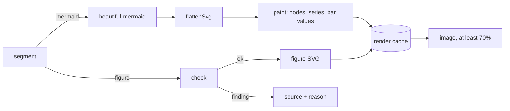

# Render panel: prismantis's look — design

Date: 2026-11-23. Builds on [the render panel design](2026-11-22-render-panel-design.md).

## Intent

Adam runs [prismantis](https://github.com/NahumLitvin/prismantis) (MIT), a Claude Code mod that draws replies in the
terminal: tables, code, Mermaid as coloured text art, and ```` ```figure ```` text pictures. Beside it, the Render
panel's diagrams look worse. Both draw Mermaid with beautiful-mermaid 1.1.3; the difference is what prismantis does
after the renderer and where it draws:

- every node is one colour (`colors()` in `render-helper.js` gives beautiful-mermaid a single `surface`); prismantis
  gives each box, participant and bar its own theme colour;
- bar charts have no values; prismantis prints each value above its bar and highlights the tallest;
- a ```` ```figure ```` block stays a code block with its `{accent:…}` markup showing. Prismantis's prompt hint asks
  Claude for figures, so with prismantis installed they are common;
- a wide diagram shrinks to the panel: in the default 360 px panel (332 px drawn) a 750 px chart is shown at 44%.

The goal: the panel's diagrams hold up next to prismantis's, keeping what only the panel does (Codex, the session's
diagrams, Markdown files, zoom).

## Goals

1. **A colour per node**: flowchart and state nodes, class boxes, ER entities, sequence participants, and each series
   of a multi-series chart, from the Herdr theme.
2. **Values on bar charts**: a single-series bar chart prints each value above its bar; the tallest is highlighted.
3. **Figures**: ```` ```figure ```` blocks in prismantis's syntax are drawn, as SVG images like diagrams (cached,
   clickable to zoom). One that fails prismantis's checks shows its source with the reason.
4. **A minimum size**: a diagram or figure is never shown below 70% of its natural size; one wider than the panel at
   that size scrolls sideways.

## Non-goals

- GitHub alerts (`> [!NOTE]`), table and code styling: Markdown stays `TextView.markdown` as today. A possible
  follow-up.
- Prismantis's text-art look in the panel (option C below, not picked).
- Copying text out of a figure (F1 below, not picked).
- Pie, gantt and other diagram kinds: as beautiful-mermaid draws them today, painted only where they carry the
  groups named below.
- Depending on prismantis at run time, or changing it.

## Anti-goals

- A diagram that rendered before and now doesn't. A failure in the new painting falls back to today's SVG, never to an
  error box.
- Stale diagrams: an SVG cached before this change shown after it.
- Colours that ignore the Herdr theme, or are unreadable in a light theme.

## Approaches

- **A: keep the SVG renderer and add the missing pieces** (picked). Vector shapes and real fonts, scales, zoom stays
  useful; the work is ours.
- **C: switch to prismantis's text art** (beautiful-mermaid's ASCII renderer plus prismantis's patches and painter).
  The panel would match the terminal exactly, but text art can't shrink: the default panel holds about 40 monospace
  columns and prismantis sizes charts up to 60, so most diagrams would scroll. It would also repeat what the terminal
  already shows and copy code we'd keep in step with prismantis by hand. Rejected.
- **A plus figures** (picked): A, with prismantis's figure syntax and checks ported. For drawing figures:
  - **F1: text in the panel**, rows of coloured monospace text. Selectable, but a second way of drawing in the panel,
    no zoom, and a glyph missing from the mono font falls back to another font and can push the rest of its row.
  - **F2: SVG made by the helper** (picked). Figures behave exactly like diagrams (cache, zoom, the 70% rule), and each
    character is placed at its own column, so rows can't drift and `▏───▏` time axes stay lined up. Not selectable.

## Design



### Theme and cache

- `request()` in `src/mods/dock-render/main.js` sends today `background, foreground, muted, border, accent, dark`. It
  also sends `dim` and `ansi1`–`ansi6` (red, green, yellow, blue, magenta, cyan; `theme()` names `ansi0`–`ansi15`).
- The cache name stays `<hash of source>-<theme id>.svg`. The theme id becomes the hash of the theme **and a look
  version** (a constant in the helper, bumped whenever the drawing changes), so no SVG cached before this change, or
  before a later change to the painting, is shown again. Old files age out by the existing 14-day tidy.
- A figure and a Mermaid block with the same text would share a name: the source hash includes the kind.

### A colour per node (new `src/shared/render/paint.js`, pure)

- Runs on the flattened SVG. beautiful-mermaid marks each part: `<g class="node" data-id=…>` (flowchart, state),
  `class-node` (class), `entity` (ER), `actor` (sequence). Each distinct `data-id`, in order of first appearance,
  takes the next palette colour: its shape's stroke and its label take the colour, its fill a faint tint of it over the
  background (`mix()` from `flatten.js`). Edges, messages and arrowheads keep today's colours. State start and end
  markers (`_start`, `_end`, and numbered ones such as `_start2` in composite states) keep theirs.
- **Colours the author set are kept** (my call). beautiful-mermaid draws `classDef` / `class` and `style` colours, and
  Claude uses them for meaning (failed, done, new). A node whose fill, stroke or label differs from the defaults
  `colors()` gives is left exactly as drawn, even when only one of them was set, and takes no palette colour, so the
  painted nodes' colours stay distinct and in order.
- **Palette** (my call): `ansi4, ansi6, ansi2, ansi5, ansi3, accent`, duplicates dropped. Red is left out: it reads as
  an error. A colour too close to the background to read is dropped (the builder picks the threshold); if none is left,
  everything takes `accent`.
- **Multi-series charts**: the bars and lines of series N (`xychart-color-N`) take palette colour N.
- Anything that goes wrong (an unexpected shape, a throw, a result that fails `flattenSvg`'s browser checks) gives
  back the SVG unpainted.

### Values on bar charts (in `paint.js`)

- Only a chart with exactly one series, a bar series, drawn vertically (no `horizontal`), as prismantis does.
- Each bar is `<path|rect class="xychart-bar …" data-value="46" data-label="11h">`; its box comes from its `d` (or
  `x/y/width/height`). A `<text>` with the value goes centred a few pixels above the bar (below it for a negative
  value), in `muted`. The tallest bar takes `accent`, the others a muted tint (my call, after prismantis).
- If a label would leave the drawing (a bar reaching the top), the viewBox and height grow to hold it.

### Figures (new `src/shared/render/figure.js`, pure)

Ported from prismantis's `hooks/figure.tsx` (MIT, © 2026 Nahum Litvin), credited in the file's header and in the
README the way `flatten.js` credits herdr-chat.

- **Segments**: `splitSegments` (`markdown.js`) also turns a fence whose info string is `figure` (any case) into
  `{ kind: "figure", source, id }`. A fence not closed yet stays text, as for Mermaid.
- **Syntax**: `{role:text}` runs, roles `accent, warn, ok, note, dim, strong`, not nested; `▶ ◀` drawn as `► ◄`.
- **Checks**, as prismantis words them: at most 100 columns and 80 lines; no tab, control character, direction mark or
  invisible character; no glyph that may draw as an emoji or takes two columns; role markup misspelled, wrong case,
  nested or left open. Leading and trailing blank lines are dropped. Prismantis's "wider than the terminal" check is
  dropped: the panel scrolls. The first finding becomes `{ kind: "figure", error: "figure line 4: …", source }`.
- **Widths**: graphemes with `Intl.Segmenter`, column widths with prismantis's `width()` (its wide-character rule).
- **SVG**: a monospace grid. Every character sits at `x = pad + column × cell width` (an `x` list per run), so the
  font's own advance never moves a column; `█` is drawn as a rect filling its cell, so bars are solid and meet.
  Colours: no role → `foreground`; `accent` → `accent`; `warn` → `ansi1`; `ok` → `ansi2`; `note` → `ansi3`; `dim` →
  `dim`; `strong` → `foreground`, bold. A background rect in `background`. Sizes (cell width, line height, font size,
  padding) are the builder's. It goes through the same cache as a diagram.

### Diagrams view

- `fold()` in `transcript.js` collects figures as well as Mermaid blocks: each `{ kind, source, id, at }`, in one
  list, newest first, the same cap of 40. The helper draws each by its kind. (My call: a figure is a picture of the
  session like a diagram.)
- Files gets figures for free through `segments()`.

### The panel

- `segments()` in `main.js` draws both kinds with `diagram()`. A failed figure shows its reason in the dim colour,
  then its source as a code block (prismantis's words); a failed diagram stays as today.
- **Width rule** (a pure function, tested): natural width `n`, room `m` (panel width minus padding). Shown width is
  `n` when `n ≤ m`, else `max(m, 0.7 × n)`, never below 40; height keeps the ratio. When the shown width is over `m`,
  the image sits in a box `m` wide with `overflow_x_scrollbar()`. Clicking the image still opens the zoom; the zoom
  dialog is unchanged.

### Tests

- `tests/render-core.test.mjs`: `splitSegments` with figures (closed, open, `FIGURE` case); each figure check and its
  message; the figure SVG (columns at fixed x, `█` as a rect, role colours, nothing `flattenSvg` would reject);
  `paint.js` (each node group a palette colour, `_start`/`_end` untouched, a `classDef` or `style` node kept and
  skipping no colour, series colours, a broken SVG given back unchanged); bar values (single series only, horizontal skipped, tallest highlighted, negative below, viewBox grown);
  the palette's dropping of duplicates and unreadable colours; the width rule.
- `tests/render-helper.test.mjs`: a fixture with a figure, a flowchart and a bar chart gives the right kinds and
  writes each SVG; a changed theme or look version gives new file names; the Diagrams list holds figures.
- `npm test`, `npm run deploy` (it runs `herdr-app check`), then tried live: the same sample, in a dark and a light
  theme, in the panel and in the zoom.

### Docs

README's Render section: figures, colours, the 70% rule, the prismantis credit. RECIPE's `dock-render` line: "Mermaid
diagrams and figures".

## Work

On branch `render-prismantis-look`, cut from `main`, merged back by fast-forward.

## Left to the builder

- Sizes and offsets: figure cell width, line height, font size and padding; the bar label's offset and size; the tint
  amount.
- The readability threshold that drops a palette colour.
- How the figure SVG is split into `<text>` elements, and the new modules' exact names.
